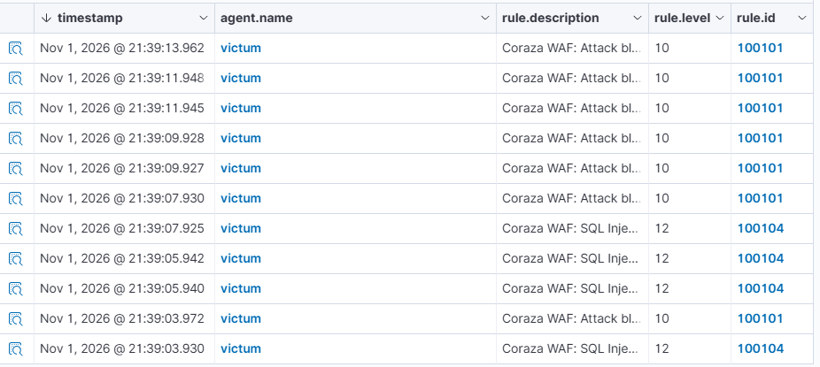
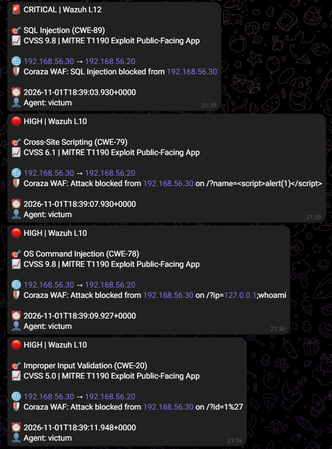
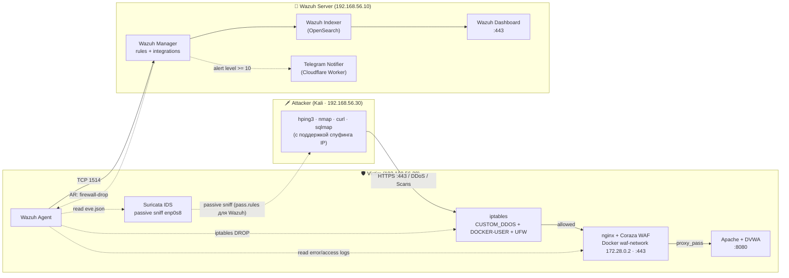

# Detection Lab

 

Изолированная лаборатория для эмуляции атак и валидации детекта. Архитектура реализует паттерн **Defense in Depth** и выстроена по цепочке: **Network IDS (L3/L4) → Web WAF + Reverse Proxy (L7) → SIEM → Active Response**.


---

## Архитектура



***

## Detection Coverage Matrix

Таблица показывает, какие слои защиты (iptables, Suricata, WAF, Nginx, Wazuh, Active Response) задействованы при отражении конкретных типов атак.

### L3/L4 Атаки (Сеть и Транспорт)

| Атака | iptables (Rate Limit) | Suricata (Rule ID) | Wazuh (Rule ID) | Active Response |
|:---|:---:|:---:|:---:|:---:|
| **SYN Flood** | ✅ 100 pps | ✅ `1000001` | `100200` | ✅ 600s |
| **UDP Flood** | ✅ 200 pps | ✅ `1000002` | `100201` | ✅ 600s |
| **ICMP Flood** | ✅ 10 pps | ✅ `1000009` | `100204` | ✅ 600s |
| **ACK Flood** | ✅ 100 pps | ✅ `1000010` | `100205` | ✅ 600s |
| **RST Flood** | ✅ 100 pps | ✅ `1000011` | `100206` | ✅ 600s |
| **LAND Attack** | ✅ Drop | ✅ `1000012` | `100207` | ✅ 600s |
| **Invalid Flags** | ✅ Drop | ✅ `1000013/14` | `100207` | ✅ 600s |

### L4 Сканирования (Reconnaissance)

| Атака | iptables | Suricata (Rule ID) | Wazuh (Rule ID) | Active Response |
|:---|:---:|:---:|:---:|:---:|
| **Nmap SYN Scan** | — | ✅ ET SCAN | `100203` | ✅ 300s |
| **XMAS Scan** | ✅ Drop | ✅ `1000003` | `100202` | ✅ 600s |
| **NULL Scan** | ✅ Drop | ✅ `1000004` | `100202` | ✅ 600s (Gap) |
| **FIN Scan** | ✅ Drop | ✅ `1000005` | `100202` | ✅ 600s |

### L7 Атаки (Веб-приложения)

| Атака | WAF (Coraza/CRS) | Nginx (Rate Limit) | Wazuh (Rule ID) | Active Response |
|:---|:---:|:---:|:---:|:---:|
| **SQL Injection** | ✅ CRS 942100 | — | `100101, 100104` | — |
| **XSS** | ✅ CRS 941100 | — | `100101` | — |
| **Command Injection** | ✅ CRS 932100 | — | `100101` | — |
| **LFI** | ✅ CRS 930100 | — | `100101` | — |
| **SQLMap (UA)** | ✅ Custom 10004 | — | `100101` | — |
| **HTTP Flood** | — | ✅ 429 Too Many | `100300` | ✅ 600s |
| **Slowloris** | — | ✅ limit_conn | `100302` | ✅ 600s (Gap) |

### Прочее

| Атака | Защита | Wazuh (Rule ID) | Реакция |
|:---|:---|:---:|:---|
| **SSH Brute Force** | Fail2Ban (iptables) | `5760` (логи) | Fail2Ban (1 час) |
| **Telegram Notifier** | Python Integration | — | Отправка алертов (Level 10+) |

***

## Стек технологий

| Слой | Инструмент | Версия |
|:---|:---|:---|
| SIEM | Wazuh (Manager + Indexer + Dashboard) | 4.14.9 |
| IDS (L3/L4) | Suricata + ET Open | 8.0.7 |
| WAF (L7) | OWASP Coraza + CRS | 4.30 PL1 |
| Reverse proxy | nginx (Docker, `waf-network`) | latest |
| Target | Apache + PHP 8.1 + MariaDB + DVWA | latest |
| SSH protection | Fail2Ban | 1.9 |
| Perimeter | iptables + UFW + DOCKER-USER | — |
| Notifier | Python + pyTelegramBotAPI + Cloudflare Worker | — |
| Attacker | hping3, nmap, sqlmap, hydra, slowhttptest | — |

## Быстрый старт

1. **Развернуть 3 ВМ** — пошагово в [`docs/deployment.md`](docs/deployment.md).
2. **Проверить стенд** — `sudo ./tooling/health_check.sh` (все сервисы должны быть alive).
3. **Прогнать тесты** — `./hosts/kali/attacks/run_all.sh` (интерактивные скрипты атак).
4. **Открыть Dashboard** — `https://192.168.56.10` (Wazuh UI).

Setup частично автоматизирован (`hosts/victim/network/*.sh`, `setup-waf.sh`), частично ручной (DVWA, Fail2Ban, UFW). **Точный split — в `docs/deployment.md`**.


## ⚠️ Известные ограничения (Gap Analysis)

1. **Slowloris (HTTP/2 Gap):** Nginx настроен на HTTP/2 и отбивает невалидные HTTP/1.1 заголовки кодом `400` до срабатывания таймаута.
2. **Race Condition (L3 vs L7):** При HTTP Flood Suricata (L3) срабатывает быстрее и банит IP через Active Response, поэтому Nginx (L7) не успевает выдать 429.
3. **Fail2Ban Integration:** Логи банов не парсятся Wazuh (нет нативного декодера), хотя попытки SSH-логина Wazuh видит.
4. **NULL Scan (VirtualBox):** Пакеты с нулевыми флагами отбрасываются ядром гипервизора до Suricata.

Полный разбор → [`docs/gap-analysis.md`](docs/gap-analysis.md).

## Документация и Доказательства

*   [`docs/evidence.md`](docs/evidence.md) — **Доказательства работы (скриншоты Wazuh и Telegram).**
*   [`docs/scripts.md`](docs/scripts.md) — Полный справочник всех скриптов и файлов.
*   [`docs/architecture.md`](docs/architecture.md) — Потоки данных и Defense in Depth.
*   [`docs/detection-rules.md`](docs/detection-rules.md) — Кастомные правила Suricata, Wazuh, WAF.
*   [`docs/hardening.md`](docs/hardening.md) — Настройки iptables, Nginx, Docker, UFW.
*   [`docs/gap-analysis.md`](docs/gap-analysis.md) — Честный анализ ограничений.
*   [`docs/troubleshooting.md`](docs/troubleshooting.md) — 20+ реальных проблем и их решения.
*   [`docs/deployment.md`](docs/deployment.md) — Инструкция по развертыванию.

## Структура репозитория

```text
├── hosts/                  # Конфиги по машинам (Wazuh, Victim, Kali)
├── docs/                   # Полная документация
├── tooling/                # health_check, correlate, telegram_bot
└── README.md
```

## Лицензия
[MIT](LICENSE)
