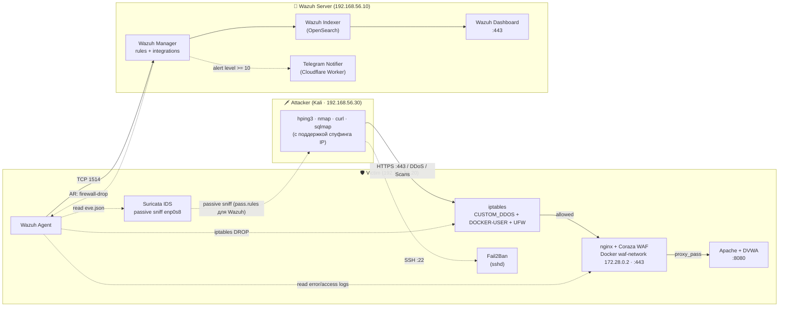

# Архитектура и потоки данных

Лаборатория спроектирована по принципу **Defense in Depth (Эшелонированная защита)**. Каждый слой выполняет свою задачу, не дублируя функции других слоев, а Wazuh выступает в роли центрального SIEM для корреляции событий и автоматического реагирования.

## Топология и компоненты

Стенд состоит из трёх виртуальных машин, связанных изолированной сетью Host-Only.

| Хост | IP (Host-Only) | Роль | Компоненты |
|:---|:---|:---|:---|
| **Wazuh Server** | `192.168.56.10` | SIEM | Manager, Indexer, Dashboard, Telegram Integration |
| **Victim** | `192.168.56.20` | Защищаемый хост | Suricata, Nginx + Coraza WAF (Docker), DVWA, Wazuh Agent, Fail2Ban |
| **Attacker** | `192.168.56.30` | Машина атакующего | Kali Linux (hping3, nmap, curl, sqlmap) |

### Сетевая изоляция
1. **Host-Only (`192.168.56.0/24`)**: Изолированная сеть для взаимодействия ВМ. Изолирована от интернета и основной сети хоста.
2. **NAT (`10.0.2.0/24`)**: Второй адаптер на каждой ВМ для доступа в интернет (скачивание пакетов, обновление баз).
3. **Docker-сеть (`172.28.0.0/24`)**: Выделенная сеть `waf-network` на Victim. WAF-контейнер имеет фиксированный IP `172.28.0.2` (это упрощает написание правил UFW и `iptables DOCKER-USER`).

## Схема потоков данных

## 🛡️ Слои защиты (Defense in Depth)

### 1. Периметр (L3/L4) — iptables + UFW
На Victim настроена политика `DROP` по умолчанию для входящих соединений. Разрешены только порты `22` (SSH), `80` (HTTP), `443` (HTTPS) и `8080` (только для Docker-сети WAF). 
Дополнительно создана цепочка `CUSTOM_DDOS`, которая применяется первой в `INPUT`. Она отсекает SYN/UDP/ICMP флуды с помощью `hashlimit` и блокирует невалидные флаги TCP (NULL, XMAS, FIN).

### 2. Сетевой IDS (L3/L4) — Suricata
Suricata работает в пассивном режиме (sniffing) на интерфейсе `enp0s8`. Она не стоит в разрыве сети, а копирует трафик через AF_PACKET. 
**Важное архитектурное решение:** В конфигурацию Suricata добавлен файл `pass.rules`, который игнорирует трафик от/к Wazuh Server (`.10`). Это предотвращает ложные срабатывания (False Positives) и защищает сервер от случайного бана через Active Response (из-за большого объема логов, отправляемых агентом по TCP 1514).

### 3. WAF (L7) — Nginx + OWASP Coraza
Nginx терминирует TLS-соединения. Он проксирует расшифрованный HTTP-трафик на Apache/DVWA. Внутри Nginx подключен модуль Coraza (OWASP CRS 4.30 PL1), который инспектирует пейлоад на наличие SQLi, XSS, CMDi, LFI и обфускации. 
Nginx также выполняет роль L7 Rate-Limiter (`limit_req` — 20r/s, `limit_conn` — 20 на IP).

### 4. Защита SSH — Fail2Ban
Fail2Ban работает как независимый локальный агент на Victim. Он мониторит `/var/log/auth.log` и при 3 неудачных попытках входа по SSH блокирует IP-адрес атакующего через `iptables` (цепочка `f2b-sshd`) на 1 час.

### 5. SIEM и реагирование — Wazuh
Агент на Victim собирает логи из нескольких источников:
1. `eve.json` (алерты Suricata, L3/L4)
2. `audit.log` (алерты WAF, JSON, L7)
3. `access.log` и `error.log` (HTTP-коды и таймауты Nginx)
4. Системные логи (`auth.log`, `syslog`, `dpkg.log`)

Wazuh Manager коррелирует эти события, применяет правила (включая MITRE ATT&CK маппинг) и при алертах Level 10+ инициирует **Active Response**.
Важная деталь: **Active Response выполняется на самом агенте (Victim)**, а не на сервере. Manager лишь отправляет команду, а локальный скрипт `firewall-drop` правит `iptables` на Victim.

### 6. Уведомления — Telegram Integration
Wazuh Integration запускает Python-скрипт, который формирует красивое сообщение (с CWE, CVSS, MITRE) и отправляет его через Cloudflare Worker (так как прямой доступ к API Telegram из РФ заблокирован). Скрипт использует дедупликацию (Anti-Spam Cache), чтобы не отправлять одинаковые алерты чаще, чем раз в 5 минут.

## ⚠️ Как данные проходят через WAF (Docker)
Проброс портов в Docker (`-p 443:443`) создает правила в цепочке `DOCKER-USER`. Трафик от Kali приходит на `enp0s8` -> проходит через `iptables INPUT` -> попадает на Nginx в контейнере. Nginx проксирует запрос на `172.28.0.1:8080` (хост). Правило `DOCKER-USER` разрешает этот трафик, а UFW пропускает его только от IP `172.28.0.2`.
