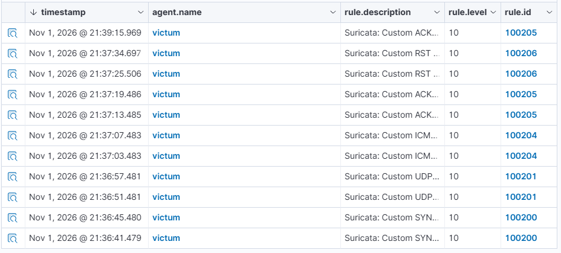
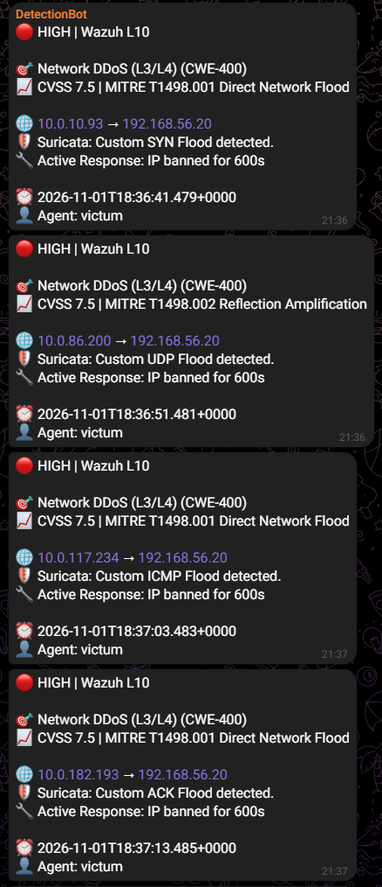
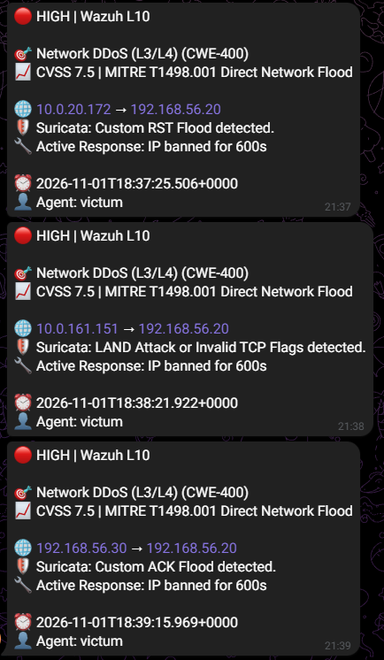
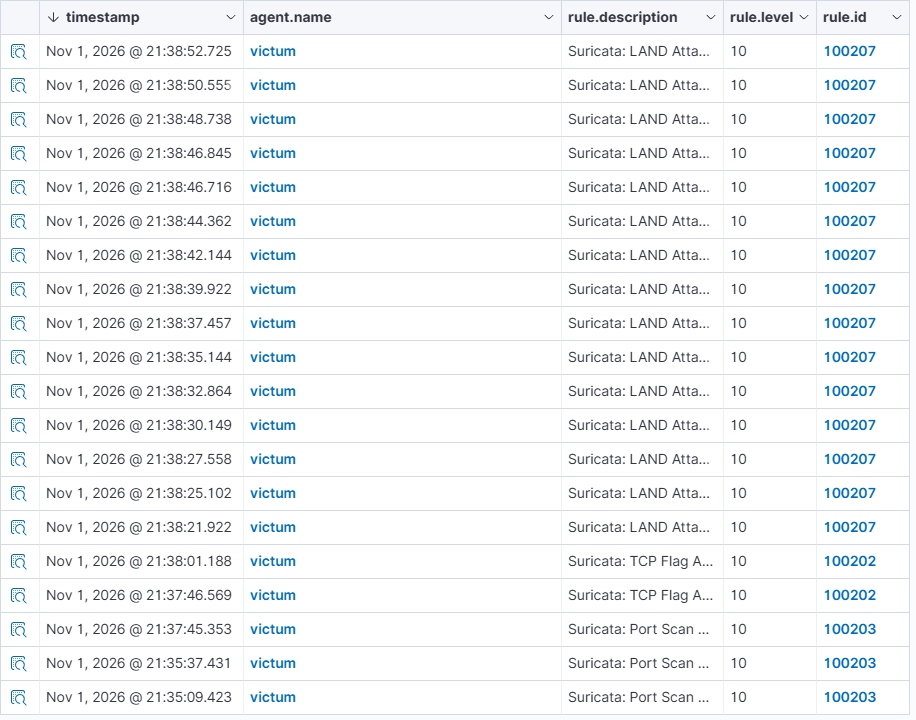
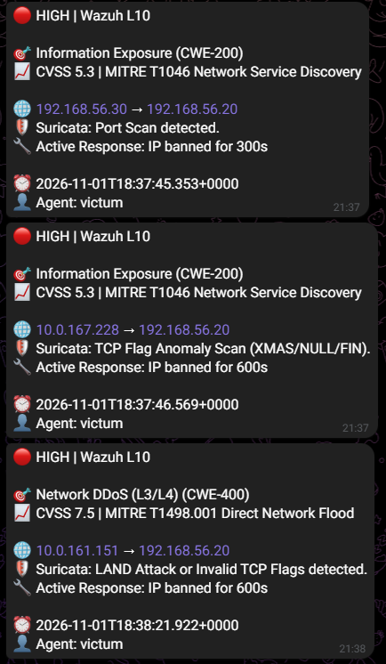
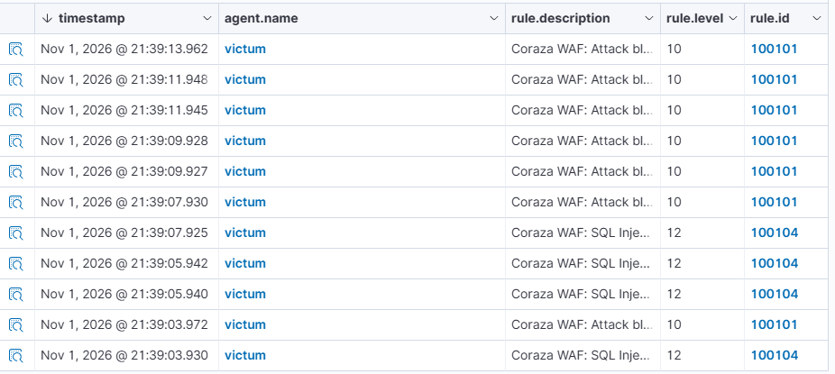
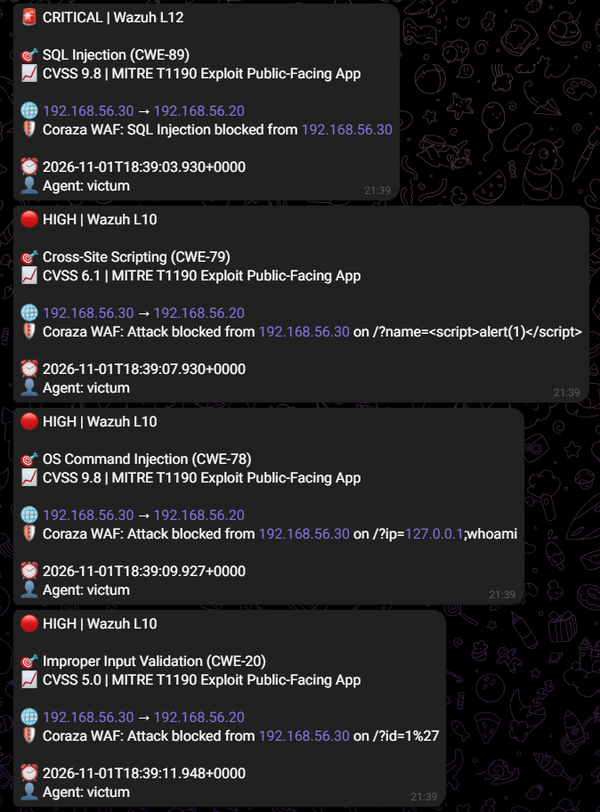
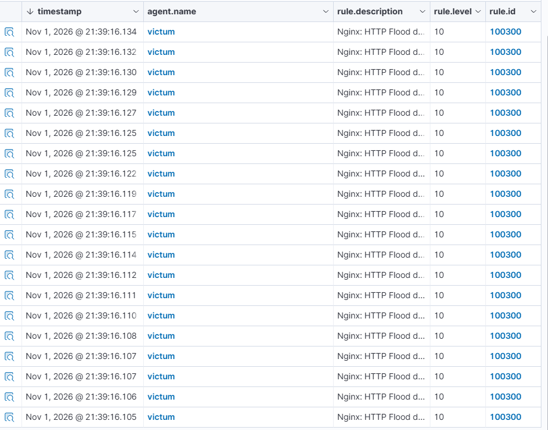
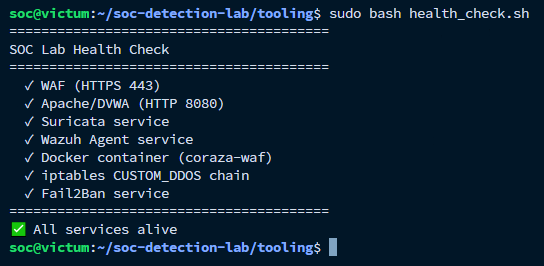

# Testing Evidence (Доказательства работы)

Этот документ содержит визуальные доказательства успешного детектирования и реагирования на атаки в рамках лабораторного стенда. Все скриншоты сделаны в ходе реального тестирования.

## 1. L3/L4 DDoS (Network Layer)

**Атака:** SYN, UDP, ICMP, ACK, RST Flood (с подменой IP).
**Детект:** Suricata (правила `1000001-1000011`) -> Wazuh (`100200-100206`).
**Реакция:** Active Response (`firewall-drop`).

**Wazuh Dashboard (Алерты):**

**Telegram Notifier (Уведомление):**

---

## 2. Сканирование портов (Reconnaissance)

**Атака:** Nmap SYN Scan, XMAS, NULL.
**Детект:** Suricata ET SCAN -> Wazuh (`100203`, `100202`).
**Реакция:** Active Response (бан на 300/600 сек).

**Wazuh Dashboard (Алерты):**

**Telegram Notifier (Уведомление):**

---

## 3. OWASP Top 10 & WAF (Application Layer)

**Атака:** SQL Injection, XSS, Command Injection, LFI, обфускация (SQLMap).
**Детект:** OWASP Coraza WAF -> Wazuh (`100101`, `100104`).
**Реакция:** Блокировка запроса (HTTP 403).

**Wazuh Dashboard (Алерты):**

**Telegram Notifier (Уведомление):**

---

## 4. HTTP Flood (L7 DDoS)

**Атака:** 60 параллельных запросов на веб-сервер.
**Детект:** Nginx `limit_req` (HTTP 429) -> Wazuh (`100300`).
**Реакция:** Active Response (бан на 600 сек).

**Wazuh Dashboard (Алерты):**

---

## 5. Проверка здоровья стенда (Health Check)

Запуск скрипта `tooling/health_check.sh` подтверждает, что все 7 ключевых сервисов работают корректно.

